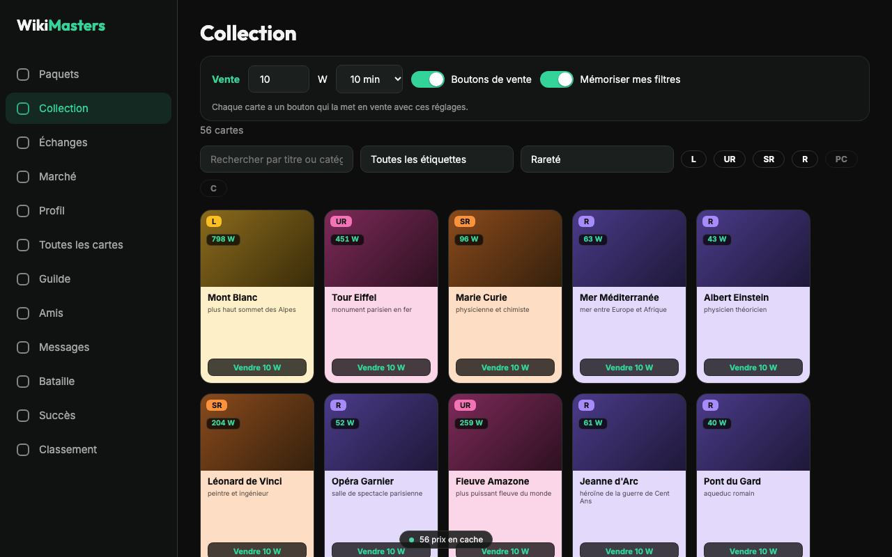

# Outils de prix pour WikiMasters

[English](README.md)

Extension Chrome (Manifest V3, JavaScript sans build) pour [wiki-masters.com](https://www.wiki-masters.com) : prix moyens des cartes, valeur estimée de la collection, raccourcis de vente et d'enchère.

Projet indépendant, ni édité, ni approuvé, ni parrainé par WikiMasters.



## Fonctions

- **Prix moyen sur chaque carte** (collection, marché, enchères, paquets, échanges). Un prix calculé est gardé et ne se met à jour que sur un clic.
- **Estimation de la collection** : valeur totale, répartition par rareté, filtres par rareté, étiquette et texte, progression avec temps restant.
- **Tri « Prix décroissant »** ajouté au tri de la collection, avec les filtres du site.
- **Bouton Vendre** sur chaque carte (montant et durée réglés une fois) et **bouton Enchérir** sur les ventes du marché (mise minimale).
- **Filtres mémorisés** et **raccourcis clavier** pour les paquets.

Les actions (vente, mise, ouverture) ne partent que sur un clic. Les prix sont chargés un par un, à un rythme qui suit les limites du site. Voir [docs/ARCHITECTURE.md](docs/ARCHITECTURE.md).

## Confidentialité

Rien n'est envoyé à l'auteur ni à un tiers. Les données restent dans `chrome.storage.local`. Détail : [politique de confidentialité](docs/privacy.html).

## Installer

Depuis le Chrome Web Store (lien à venir), ou en local :

1. `chrome://extensions`, activer le mode développeur.
2. « Charger l'extension non empaquetée » et choisir ce dossier.
3. Recharger wiki-masters.com.

## Développement

```
npm install
npm test               # tests unitaires et d'intégration (jsdom)
npm run package        # tests, puis dist/wikimasters-price-tools-<version>.zip
npm run store-assets   # captures et visuels du store (Chrome requis)
```

Publication : [docs/PUBLISHING.md](docs/PUBLISHING.md). Textes de la fiche : [store/listing.md](store/listing.md).

## Licence

[MIT](LICENSE)
