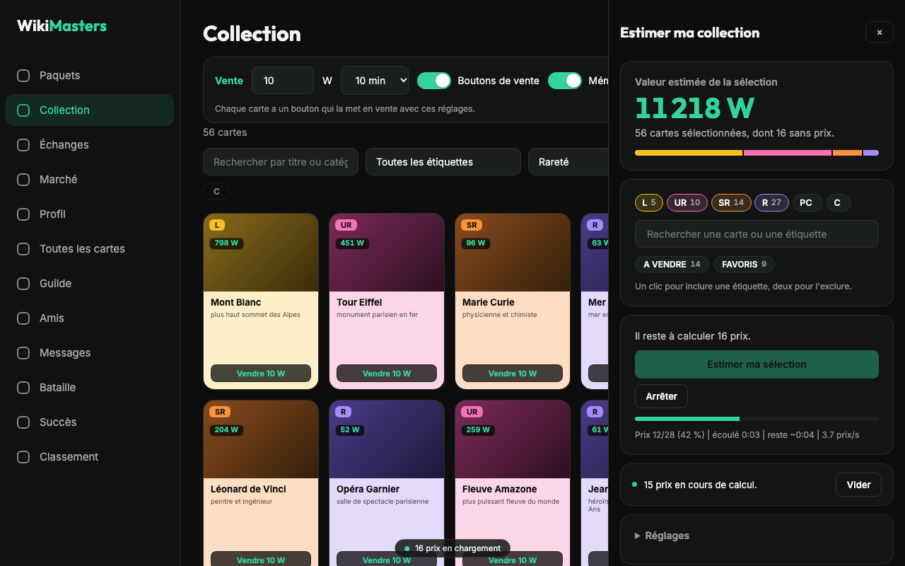

# WikiMasters - average prices and tools

[Français](README.fr.md)

A Chrome extension (Manifest V3, plain JavaScript, no build step) for [wiki-masters.com](https://www.wiki-masters.com): average card prices, collection value estimate, and sell and bid shortcuts.

Independent project, not published, endorsed or sponsored by WikiMasters.


## Features

- **Average price on every card** in the collection, market, auctions, packs and trades. A computed price is kept and only refreshed when you click it.
- **Collection estimate**: total value, breakdown by rarity, filters by rarity, tag and text, progress with remaining time.
- **"Price, descending" sort** added to the collection sort menu, working with the site's own filters.
- **Sell button** on every card (amount and duration set once) and **Bid button** on market listings (minimum bid).
- **Saved collection filters** and **keyboard shortcuts** for packs.

Actions (sell, bid, open) only happen on a click. Prices load one at a time, at a pace that follows the site's limits. See [docs/ARCHITECTURE.md](docs/ARCHITECTURE.md).

| Estimate panel | Market |
|---|---|
|  |  |

## Privacy

Nothing is sent to the author or to any third party. Data stays in `chrome.storage.local`. Details in the [privacy policy](docs/privacy.html).

## Install

From the Chrome Web Store (link to come), or locally:

1. Open `chrome://extensions` and enable developer mode.
2. Click "Load unpacked" and select this folder.
3. Reload wiki-masters.com.

## Development

```
npm install
npm test               # unit and integration tests (jsdom)
npm run package        # tests, then dist/wikimasters-price-tools-<version>.zip
npm run store-assets   # store screenshots and promo images (needs Chrome)
```

Publishing steps: [docs/PUBLISHING.md](docs/PUBLISHING.md). Store listing texts: [store/listing.md](store/listing.md).

## License

[MIT](LICENSE)
